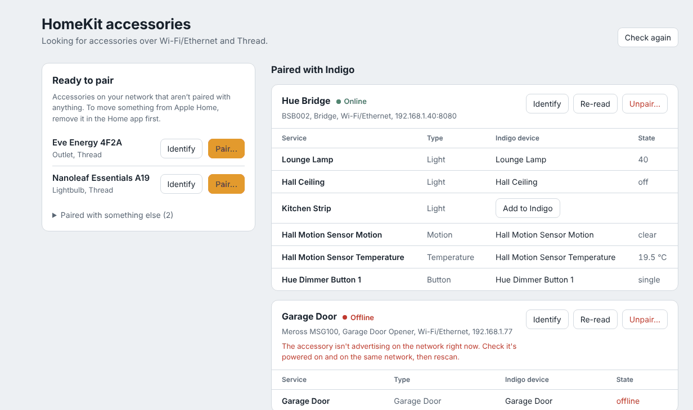

# HomeKit Device Importer for Indigo

An [Indigo Domotics](https://www.indigodomo.com/) plugin that pairs Indigo directly with HomeKit accessories and turns them into native Indigo devices — no Home app, no Homebridge, no hub in between. Lights, locks, sensors, thermostats, blinds, fans, TVs and buttons appear in Indigo with live state and full control.

## Overview

HomeKit Device Importer makes Indigo a HomeKit *controller* — the same role the Home app plays on an iPhone. You pair an accessory with Indigo using its 8-digit setup code, and each of its services (a light, a temperature sensor, a button, and so on) becomes an Indigo device you can control, put on control pages, and use in triggers and schedules.

It talks the HomeKit Accessory Protocol directly over your network, so it works with any HomeKit-certified accessory: Wi-Fi and Ethernet accessories, bridges (Hue, Aqara, IKEA and others) with all their child accessories, Thread accessories, and optionally Bluetooth LE accessories.

Changes arrive instantly as HomeKit notifications rather than by polling, so a motion sensor or button press reaches Indigo as fast as it would reach the Home app.

> **One owner per accessory.** HomeKit lets an accessory belong to only one controller. To bring something into Indigo, remove it from the Home app (or reset it) first. If you want it back in Apple Home afterwards, use Indigo's own HomeKit bridge plugin to re-share the Indigo device.

*The pairing page, shown here with sample data.*

## Supported Accessories

| HomeKit service | Indigo device | Highlights |
|---|---|---|
| **Lightbulb** | Dimmer | Brightness, RGB colour and colour temperature where supported |
| **Switch / Outlet** | Relay | Outlet-in-use; power and energy from Eve, ConnectSense and Koogeek plugs |
| **Lock** | Relay (on = locked) | Lock status, target, jammed |
| **Garage door opener** | Relay (on = open) | Opening/closing/stopped status, obstruction |
| **Window covering, window, door** | Dimmer (brightness = position) | Movement, tilt and stop actions |
| **Fan / Air purifier** | Speed control | Speed, direction, swing, auto/manual mode |
| **Thermostat** | Thermostat | Off/heat/cool/auto, setpoints, temperature, humidity, heating/cooling status |
| **Heater/cooler** (air conditioners) | Thermostat | Active, mode, heating and cooling thresholds |
| **Humidifier/dehumidifier** | Relay | Mode and humidity target actions |
| **Valve / Faucet / Irrigation** | Relay | In use, remaining time, run-time action |
| **Security system** | Custom | Home/away/night/disarmed, alarm triggered |
| **Television** | Relay | Inputs (by name), remote keys, volume and mute |
| **Stateless programmable switch / Doorbell** | Custom | Single, double and long presses as Indigo triggers |
| **Sensors** | Sensor | Temperature, humidity, light level, air quality, motion, occupancy, contact, leak, smoke, carbon monoxide, carbon dioxide |
| **Anything else** | Custom | Every readable value as a state; writable values via the generic action |

Battery level, accessory information (manufacturer, model, serial, firmware) and filter status are folded into each device rather than becoming devices of their own. Cameras' video streams are not supported; a camera's motion sensor or doorbell button still comes through.

### Every characteristic, not just the common ones

As well as the friendly states above, every readable HomeKit characteristic on a device becomes an Indigo state named `hk…` — `hkHue`, `hkBatteryLevel`, `hkStatusTampered`, `hkVendorEveEnergyVoltage` and so on, including vendor-specific characteristics. Anything an accessory can do is reachable from Indigo even if the plugin doesn't have a dedicated action for it.

## Requirements

- Indigo 2023.2 or later
- The Indigo Web Server running (used to serve the pairing page)
- HomeKit accessories on the same network as the Indigo Mac, not paired with anything else
- For Thread accessories: a Thread border router on your network (HomePod mini, HomePod 2nd generation, Apple TV 4K with Ethernet, or another border router)
- For Bluetooth accessories: Bluetooth on the Indigo Mac, and permission for Indigo to use it

On first enable, Indigo installs the plugin's Python dependency ([aiohomekit](https://github.com/Jc2k/aiohomekit)) from `requirements.txt`. This takes a minute or so; nothing needs installing by hand.

## Installation

1. Download the latest `HomeKitDeviceImporter.v….indigoplugin` from the [Releases](https://github.com/Durosity/Indigo-HomeKit-Device-Importer/releases) page.
2. Double-click the file. Indigo will prompt you to install and enable it.
3. Open **Plugins → HomeKit Device Importer → Configure…** and check **Indigo web server URL** matches your server (the default is `http://localhost:8176`).

## Pairing an Accessory

1. Remove the accessory from the Home app, or reset it, so it's advertising as unpaired.
2. Open **Plugins → HomeKit Device Importer → Open Pairing Page…**
3. The accessory appears under **Ready to pair**. **Identify** makes it blink or beep, if you need to tell similar accessories apart.
4. Click **Pair…**, type or paste the 8-digit setup code from the accessory, its box or its manual, and click **Pair**.

The plugin creates a connection device for the accessory and one Indigo device per service, in a device folder named after it. For a bridge, every accessory behind it comes through in one go.

From the pairing page you can also:

- **Add to Indigo** — recreate a device you deleted, or add one when automatic creation is off
- **Re-read** — fetch the accessory's list of services again (new accessories added to a bridge appear automatically too)
- **Unpair** — tell the accessory to forget Indigo so it can be paired with Apple Home again, optionally deleting its Indigo devices. If the accessory has gone for good, **Remove anyway** forgets it on the Indigo side.

The pairing page is served by the Indigo Web Server and uses its normal login, so it's only available to people who can already sign in to your Indigo server. Pairing keys are stored in a private file in the plugin's preferences folder and are never shown on the page.

## Configuration

| Setting | Default | Notes |
|---|---|---|
| Indigo web server URL | `http://localhost:8176` | Used by the menu item that opens the pairing page |
| Create devices automatically | On | When an accessory is paired, or a bridge gains a new accessory |
| Use a folder per accessory | On | Each pairing's devices go in a folder named after it |
| Temperatures in | Celsius | Applies to thermostat and sensor values (the raw `hk…` states stay in Celsius) |
| Check-in interval | 60 s | How often to read the few values that don't send notifications, and to check the accessory is still there |
| Thread accessories | On | Find and control Thread accessories |
| Bluetooth accessories | Off | Find and control Bluetooth LE accessories |
| Only use these network addresses | blank | Limit discovery to particular interfaces on a Mac with several (VPNs, Docker networks) |
| Log commands and changes | On | `sent` and `received` lines in the Event Log, like Indigo's own devices |
| Log sensor readings | Off | Also log every temperature, humidity and light reading |
| Debug logging | Off | Detailed logging, including the HomeKit library's own log in the plugin log file |

## Actions

Native Indigo controls work as you'd expect: on/off/toggle, brightness and colour, speed, thermostat mode and setpoints, and Send Status Request. **Beep** identifies the accessory.

The plugin adds:

- **Set HomeKit Characteristic** — write any writable characteristic on any device, chosen from a list showing each one's type and range
- **Identify Accessory** and **Refresh From Accessory** — any device
- **Set Security System Mode** — home, away, night, disarmed
- **Set Fan Direction**, **Set Fan Swing**, **Set Fan or Purifier Mode**
- **Set Blind Tilt** and **Stop Blind**
- **Set Humidifier Mode** and **Set Humidity Target**
- **Set Valve Run Time**
- **Set TV Input** (chosen by name), **Send TV Remote Key**, **Set TV Volume** (up, down, mute, unmute)

Plugin menu items: **Open Pairing Page…**, **List Accessories on the Network**, **Refresh All Devices** and **Reconnect All Accessories**.

## Triggers

- **HomeKit Button Pressed** — any press, or only single, double or long presses, on a chosen button or doorbell
- **HomeKit Accessory Goes Offline or Online** — for a chosen accessory

All device states can also be used with Indigo's standard Device State Changed triggers.

## Example Use Cases

- Use a cheap HomeKit button's double press to run an Indigo action group
- Bring a Thread motion sensor or contact sensor into Indigo without a separate hub
- Control an Eve Energy plug and log its power use with Indigo's energy states
- Run a Hue or Aqara bridge's lights and sensors from Indigo directly
- Get an Indigo notification when a battery accessory drops off the network

## How It Works

The plugin runs [aiohomekit](https://github.com/Jc2k/aiohomekit), the HomeKit controller library used by Home Assistant, on a background thread. It discovers accessories over Bonjour (and Bluetooth, if enabled), pairs with them, subscribes to every characteristic that supports notifications, and reads the rest on the check-in interval. If an accessory drops off the network, its devices show Indigo's red "offline" state, and the plugin reconnects with increasing delays until it's back.

## Troubleshooting

- **Nothing appears under Ready to pair** — the accessory is probably still paired with Apple Home; check under *Paired with something else*. Otherwise make sure it's powered on and on the same network and subnet as the Indigo Mac.
- **"The accessory rejected the setup code"** — check the code. Too many wrong attempts can lock pairing until the accessory is power-cycled.
- **"Already paired with another controller"** — remove it from the Home app or reset it.
- **Thread accessories don't appear** — check *Thread accessories* is on in the plugin config and you have a border router. The Mac must be able to reach the Thread network's IPv6 addresses.
- **Bluetooth accessories don't appear** — turn on *Bluetooth accessories*, then allow Bluetooth when macOS asks. If you missed the prompt, check System Settings → Privacy & Security → Bluetooth.
- **An accessory keeps going offline** — battery and Thread accessories sleep; a longer check-in interval can help. Turn on debug logging to see why connections drop.
- **Don't pair Indigo with itself** — Indigo's own HomeKit bridge plugin advertises as a HomeKit bridge and will appear under *Paired with something else*. Pairing it here would create a loop.

## Roadmap

Possible additions for future versions:

- Adaptive Lighting for lights that support it
- Camera snapshots
- Per-device name editing from the pairing page

Suggestions, bug reports (with debug logs and the accessory's make and model) and PRs welcome.

## Credits

- [aiohomekit](https://github.com/Jc2k/aiohomekit) by Jc2k and contributors — the HomeKit controller library this plugin is built on
- [HAP-python](https://github.com/ikalchev/HAP-python) — used to simulate accessories during development

## License

MIT — see [LICENSE](LICENSE).
